# Results

All figures in this document are generated by `experiments/run_all.py` and stored in `results/figures/`. Numerical
summaries are stored as JSON in `results/data/`. The full run takes under one minute on a laptop-class CPU. Every
number quoted here is read from those JSON files or from a test assertion.

## 1. Schwarzschild geometry and the maximal extension

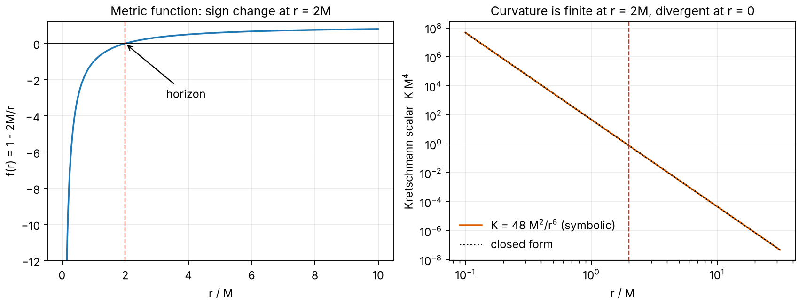

**Figure 1.** The metric function changes sign at $r = 2M$ while the Kretschmann scalar stays finite there
($K = 3/4M^4$ at the horizon) and diverges only at $r = 0$. The symbolic result $48M^2/r^6$ is plotted against the closed form.

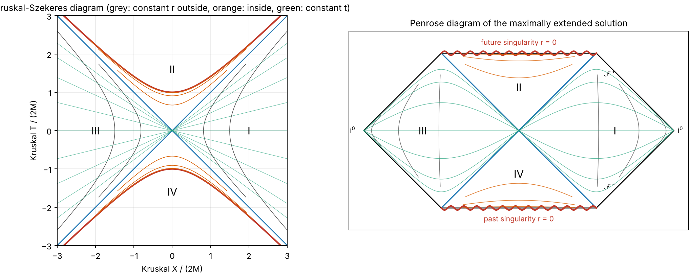

**Figure 2.** Kruskal-Szekeres and Penrose diagrams of the maximally extended solution. Regions I and III are the two
exteriors, II the black-hole interior and IV the white-hole interior. Both singularities map to the straight lines
$T_p = \pm\pi/2$. Grey curves are constant $r$ outside, orange constant $r$ inside, green constant Schwarzschild $t$.

## 2. Infalling observers and tides

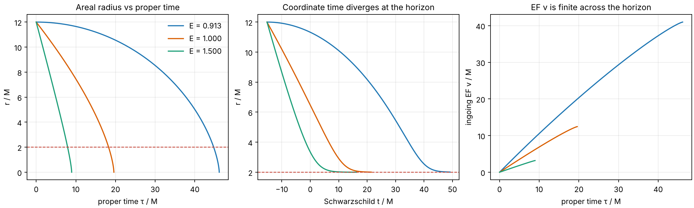

**Figure 3.** Radial infall from $r_0 = 12M$ for three energies. Proper time to cross the horizon is finite while the
Schwarzschild time diverges; ingoing Eddington-Finkelstein time $v$ stays finite, which shows that $r = 2M$ is a coordinate
singularity of the Schwarzschild chart.

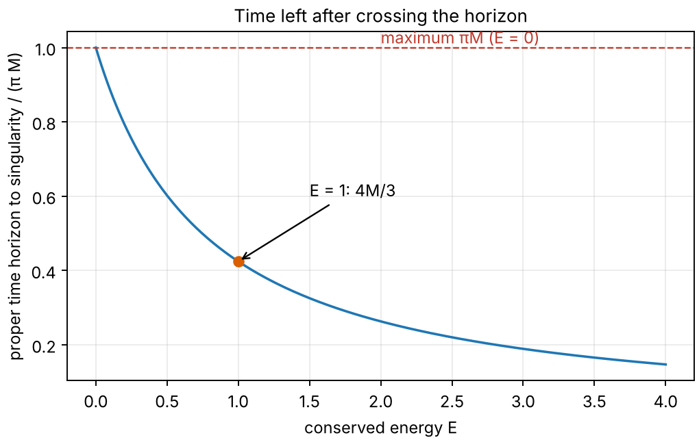

**Figure 4.** Proper time from the horizon to the singularity versus conserved energy. The maximum is $\pi M$ at
$E = 0$ and the value at $E = 1$ is $4M/3$; both are reproduced to $10^{-12}$.

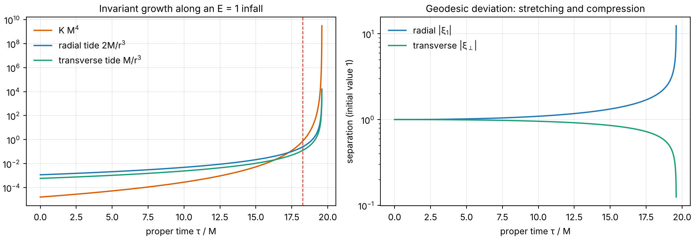

**Figure 5.** Left: Kretschmann scalar and the two tidal eigenvalues along an $E = 1$ infall. Right: solution of the
geodesic-deviation equation, with radial stretching and transverse compression.

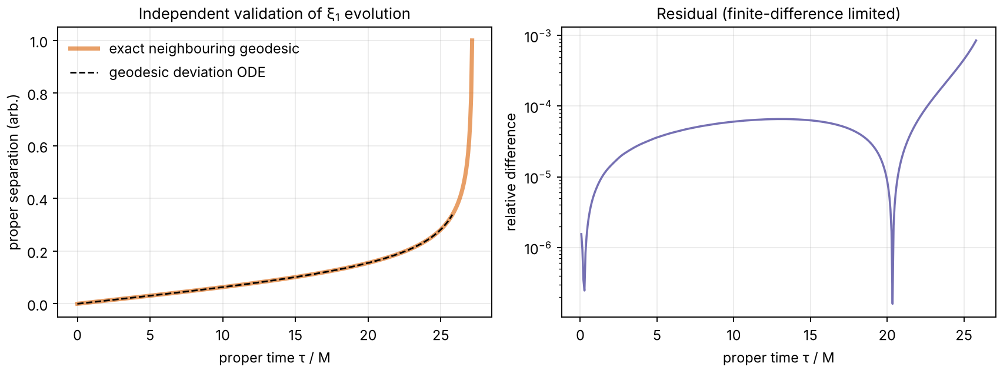

**Figure 6.** The deviation equation reproduces the exact separation of neighbouring geodesics; the maximum relative
difference is $8.5\times10^{-4}$, limited by finite differencing of the neighbouring geodesics.

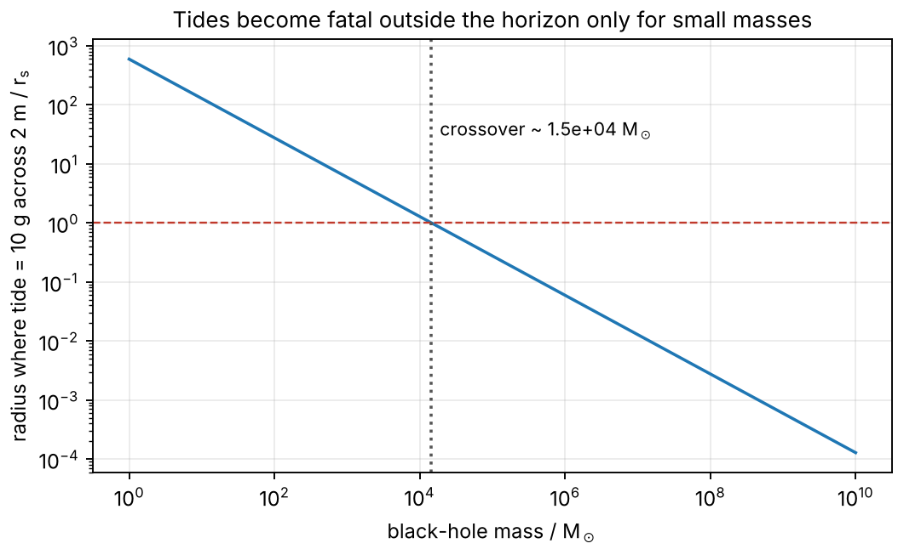

**Figure 7.** Radius where the tide across 2 m reaches 10 g, in units of the Schwarzschild radius. The crossover is at
about $1.5\times10^{4}\,M_\odot$; for heavier black holes the tide at the horizon is below this threshold.

| Mass | Tide across 2 m at the horizon | Longest possible proper time to the singularity |
| --- | --- | --- |
| $10\,M_\odot$ | $2.1\times10^{8}\ \mathrm{m/s^2}$ | $\pi M \approx 0.15$ ms |
| $4\times10^{6}\,M_\odot$ | $1.3\times10^{-3}\ \mathrm{m/s^2}$ | $\pi M \approx 62$ s |

## 3. The Einstein-Rosen bridge

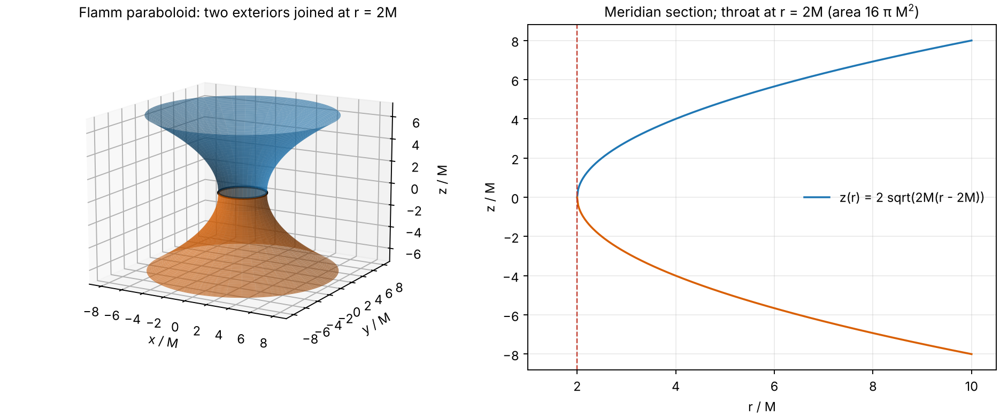

**Figure 8.** Flamm embedding of the time-symmetric slice. The two sheets meet at the throat $r = 2M$ with area $16\pi M^2$.

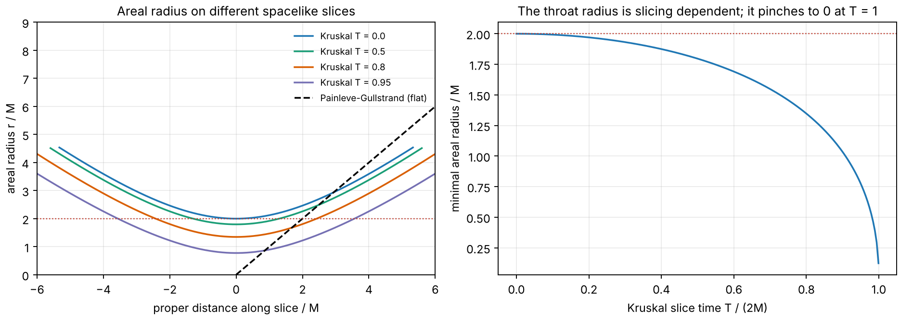

**Figure 9.** The throat is a property of the slicing. On Kruskal slices at later $T$ the minimal areal radius shrinks
($2M$, $1.80M$, $1.35M$, $0.77M$ for $T = 0, 0.5, 0.8, 0.95$ in units of $2M$) and reaches zero at $T = 1$. The
Painleve-Gullstrand slicing has a flat spatial geometry and no throat.

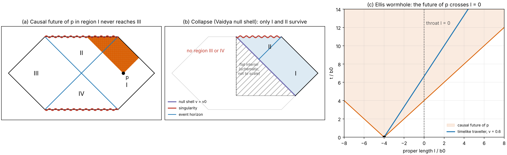

**Figure 10.** (a) The causal future of an event in region I does not contain any point of region III. A random test of
22,500 pairs found no counterexample to the necessary condition for causal connection. (b) In a collapse spacetime
regions III and IV are absent. (c) In the Ellis wormhole the future light cone of an event on one side crosses the throat.

## 4. A regular-black-hole model

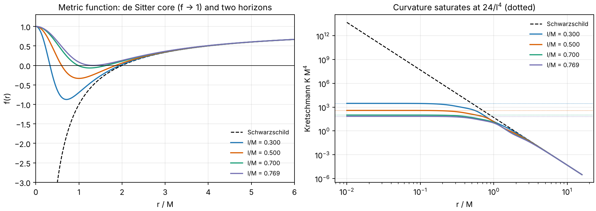

**Figure 11.** Hayward metric function (left) and Kretschmann scalar (right). The curvature saturates at $24/l^4$ at the
core (dotted lines), and the classical limit $l \to 0$ recovers Schwarzschild.

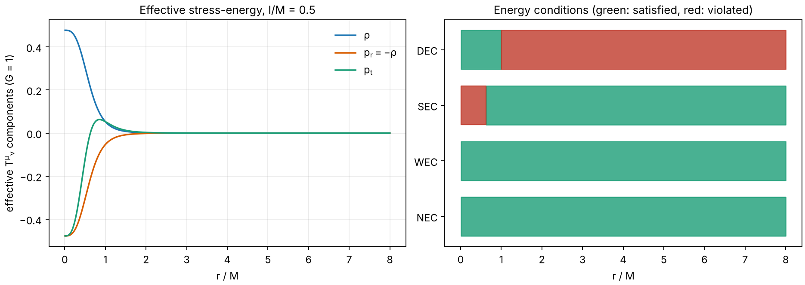

**Figure 12.** Effective stress-energy for $l = 0.5M$. The null and weak energy conditions hold everywhere; the strong
energy condition fails for $r < 0.63M$ and the dominant energy condition for $r > 1.0M$, matching the analytic thresholds
$(Ml^2)^{1/3}$ and $(4Ml^2)^{1/3}$.

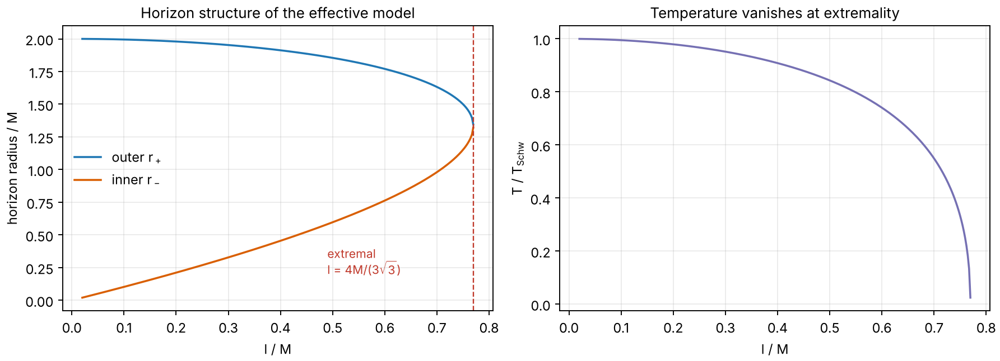

**Figure 13.** The two horizons merge at $l = 4M/(3\sqrt3) \approx 0.770M$, where the Hawking temperature vanishes.

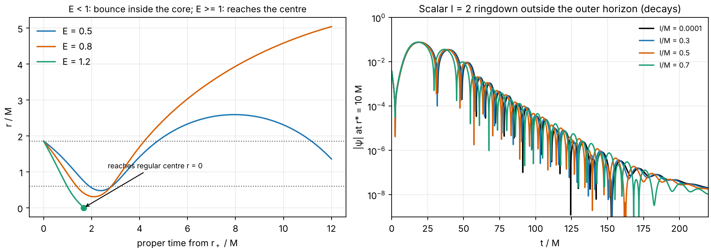

**Figure 14.** Left: radial geodesics launched inward from the outer horizon. For $E < 1$ they turn around inside the
core; for $E \ge 1$ they reach the regular centre. Right: scalar $\ell = 2$ ringdown outside the outer horizon for several
values of $l$; the signal decays in every case and the oscillation frequency increases with $l$.

| $l/M$ | $M\omega$ (scalar, $\ell = 2$, time domain) |
| --- | --- |
| $10^{-4}$ | $0.4836 - 0.0967i$ |
| 0.3 | $0.4870 - 0.0953i$ |
| 0.5 | $0.4936 - 0.0923i$ |
| 0.7 | $0.5047 - 0.0856i$ |

These values are from a single Prony fit per case and carry an uncertainty of roughly $10^{-3}$ (see Section 9).

## 5. Holography

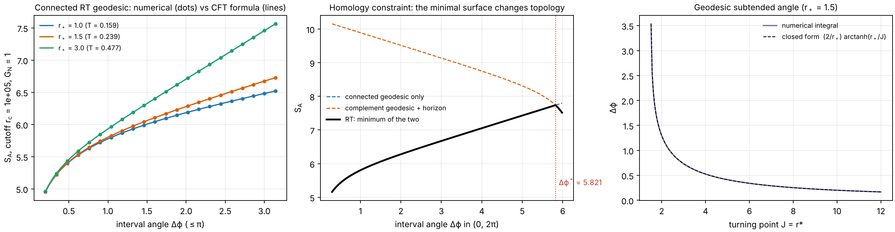

**Figure 15.** Left: numerically integrated geodesic lengths (dots) agree with the Calabrese-Cardy formula (lines); the
maximum difference is $1.4\times10^{-9}$ at cutoff $r_c = 10^5$. Middle: the full Ryu-Takayanagi prescription takes the
minimum of the connected geodesic and the complement geodesic plus horizon; the transition occurs at
$\Delta\phi^* = 5.821$ for $r_+ = 1.5$. Right: the geodesic's subtended angle agrees with its closed form to $3\times10^{-15}$.

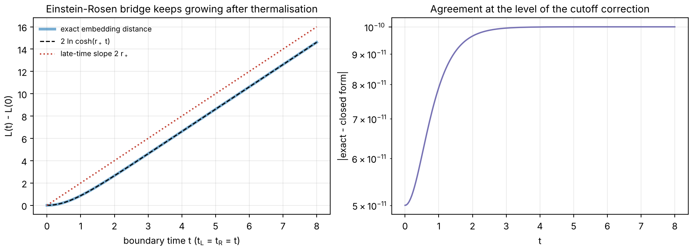

**Figure 16.** The length of the Einstein-Rosen bridge between the two boundaries follows $2\ln\cosh(r_+t)$ and grows
linearly at late times with slope $2r_+$, long after the boundary entropy has saturated. The agreement between the exact
embedding-space distance and the closed form is $10^{-10}$.

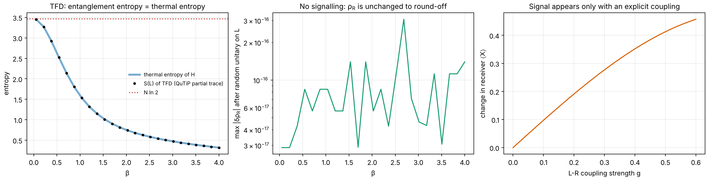

**Figure 17.** Five-qubit transverse-field Ising thermofield double. Left: entanglement entropy between the two sides
equals the thermal entropy to $4\times10^{-15}$. Middle: the reduced state on the right side does not change when an arbitrary
unitary acts on the left (largest deviation $3\times10^{-16}$). Right: a signal appears only when an explicit coupling between
the two sides is switched on.

Interpretation. In this model entanglement does not by itself allow signalling. The explicit coupling plays the qualitative
role that the double-trace interaction plays in traversable-wormhole constructions. The toy model is **not** a holographic
calculation and makes no statement about a bulk dual.

## 6. Quantum branching and decoherence

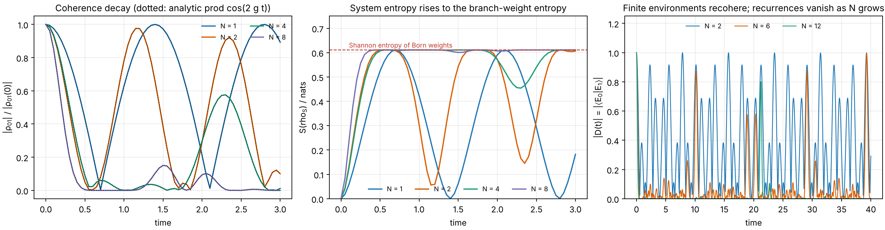

**Figure 18.** Left: coherence of the system qubit versus the analytic product $\prod_k\cos(2g_kt)$ (dotted); maximum
deviation $7\times10^{-10}$. Middle: reduced entropy rises to the Shannon entropy of the branch weights (0.611 nats).
Right: a finite environment recoheres, and the recurrences become rarer as the number of environment qubits grows.

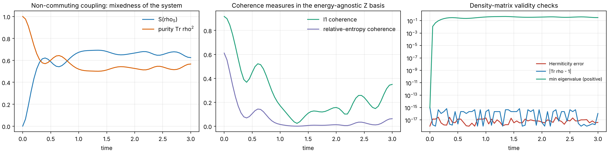

**Figure 19.** Non-commuting system-environment coupling. Mixedness and two coherence measures evolve non-trivially,
while the reduced density matrix stays valid at all times (trace error $10^{-15}$, Hermiticity error $10^{-17}$,
non-negative eigenvalues). The maximum entropy $0.6923$ stays below $\ln 2 = 0.6931$.

## 7. Time reversal

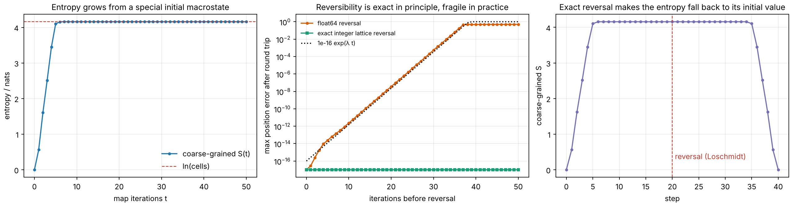

**Figure 20.** Arnold cat map. Left: coarse-grained entropy rises from a special initial macrostate to its maximum.
Middle: reversal is exact on an integer lattice but fails in floating point, with error growing as $e^{\lambda t}$,
$\lambda = \ln\frac{3+\sqrt5}{2}$. Right: exact reversal makes the entropy fall back to its initial value.

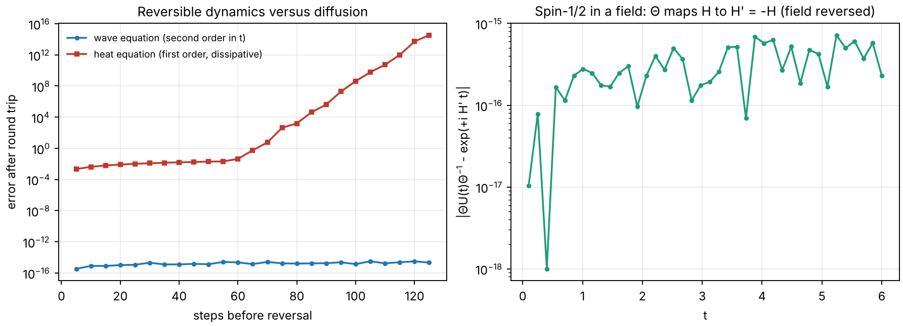

**Figure 21.** Left: the wave equation is reversible; the heat equation is not. Right: for spin-1/2, the antiunitary
$\Theta$ maps $H$ to $-H$, so the field must be reversed for the motion to retrace.

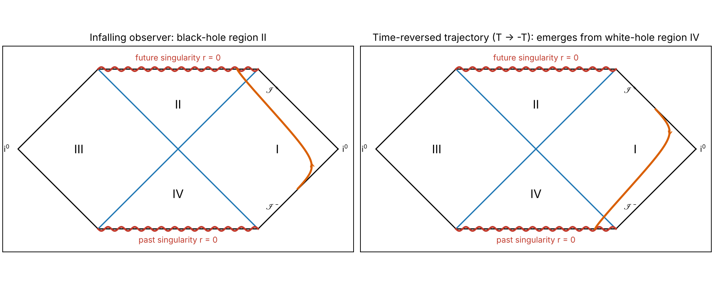

**Figure 22.** An infalling worldline in region II and its image under $T \to -T$, which emerges from the white-hole
region IV. The reversed worldline is a different solution of the same equations; it is not a description of an
observer experiencing time in reverse.

## 8. Wormholes and closed timelike curves

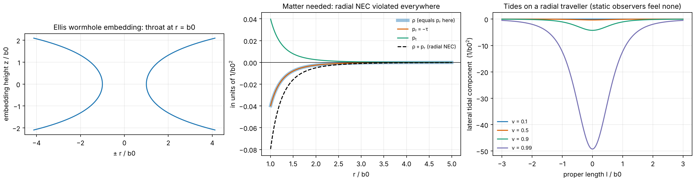

**Figure 23.** The Ellis wormhole: embedding (left), required matter with the radial null energy condition violated
everywhere (middle), and the lateral tide on a traveller crossing the throat at several speeds (right).

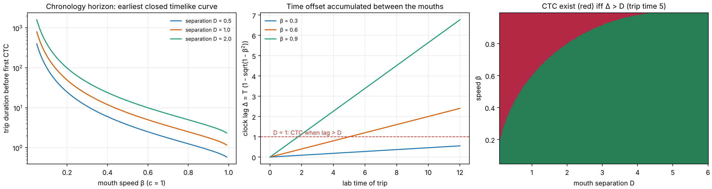

**Figure 24.** A wormhole time-shift model. Closed timelike curves appear once the clock lag exceeds the mouth separation.

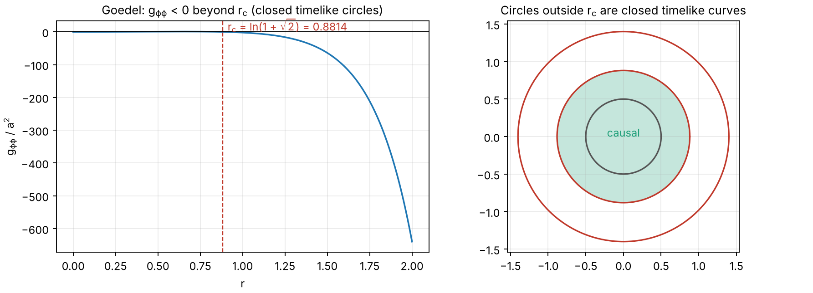

**Figure 25.** In the Goedel universe closed timelike circles exist for $r > \ln(1 + \sqrt2) = 0.8814$.

None of these results shows a physically realizable time machine. The wormhole model requires exotic matter and is expected
to be destroyed at the chronology horizon by quantum effects, and the Goedel solution has no known physical realization.

## 9. Quasinormal modes and the status of multiple regions

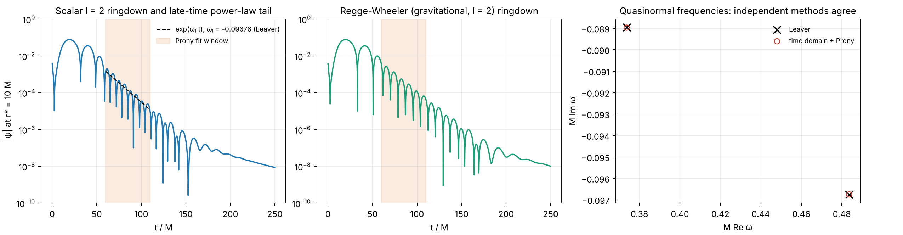

**Figure 26.** Time-domain ringdown (scalar and Regge-Wheeler potentials, $\ell = 2$) compared with Leaver's continued
fraction. The continued fraction gives $M\omega = 0.37367 - 0.08896i$ for the fundamental gravitational mode, matching the
published value to $10^{-5}$. The independent time-domain estimate is $0.37368 - 0.08897i$. For the scalar mode the two
differ by about $2\times10^{-5}$.

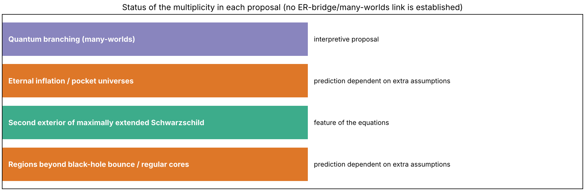

**Figure 27.** The four meanings of "multiple worlds" differ in logical status. See
[multiverse_comparison.md](multiverse_comparison.md).

## 10. Documentation figure

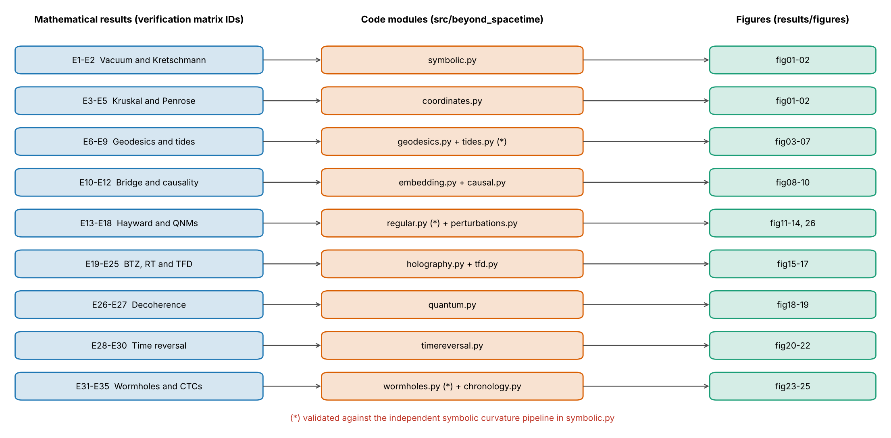

**Figure 28.** Map from mathematical results to modules to figures; see
[verification_matrix.md](verification_matrix.md).

## 11. Numerical uncertainty summary

| Quantity | Method | Typical error or uncertainty | Source of error |
| --- | --- | --- | --- |
| Proper times | DOP853, `rtol = 1e-12` | $<10^{-9}$ relative | Event localization near the singularity |
| Deviation validation | Neighbouring geodesics | $9\times10^{-4}$ relative | Finite difference with $dE = 10^{-6}$ |
| RT versus CFT | Quadrature, $r_c = 10^5$ | $1.4\times10^{-9}$ absolute | Cutoff corrections $O(r_c^{-2})$ |
| ER-bridge length | Exact embedding | $10^{-10}$ absolute | Cutoff corrections |
| QuTiP vs `expm` | ODE solver tolerance | $4\times10^{-10}$ | `sesolve` tolerance |
| Leaver QNMs | Continued fraction, depth 400 | $<10^{-5}$ versus literature | Truncation, literature rounding |
| Time-domain QNM | Leapfrog, $dx = 0.05$, Prony | about $10^{-3}$ at order 8 | Finite difference, fit window, overtone contamination |
| Hayward ringdown | Same as above | about $10^{-3}$ | Same as above |
| Cat-map error growth | Fit to $e^{\lambda t}$ | 15 percent tolerance in the test | Finite sample and saturation |

## 12. Reproducing these results

```bash
pip install -r requirements.txt
pip install -e .
python experiments/run_all.py
pytest
```
